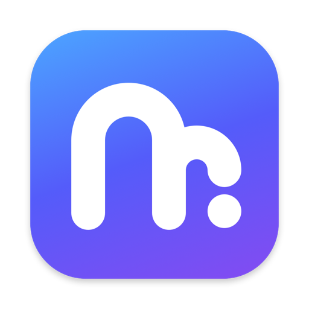
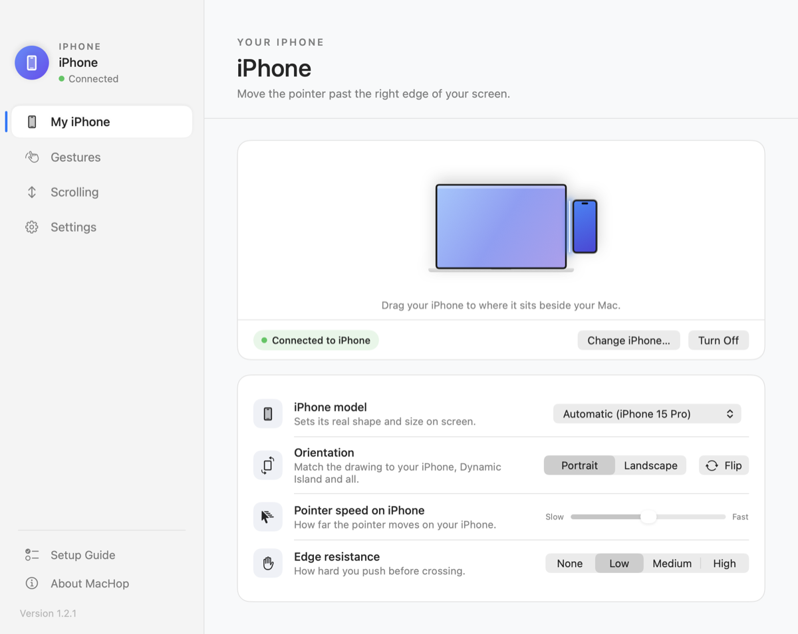
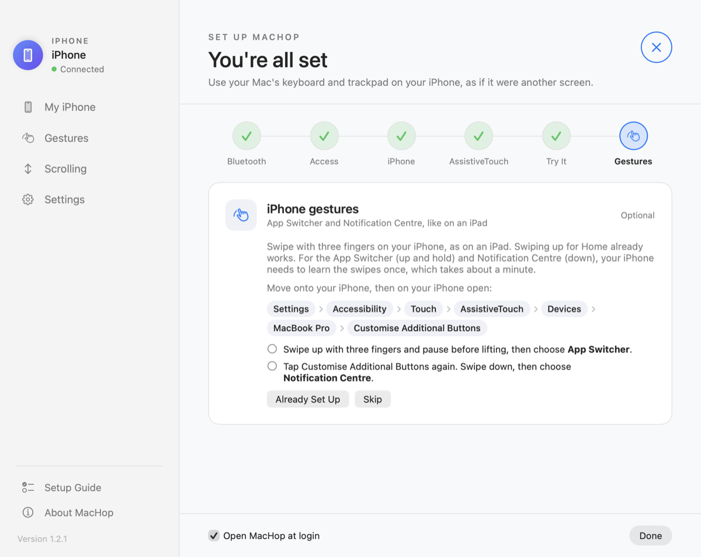
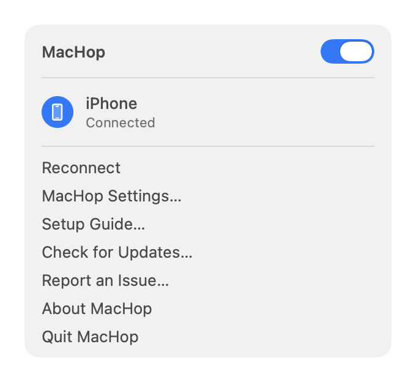

<p align="center">
  
</p>

<h1 align="center">MacHop</h1>

<p align="center">
  <b>Universal Control, but for iPhone.</b><br>
  Use your Mac's keyboard and trackpad on your iPhone. Just move your cursor off the edge of your screen.<br>
  Free and open source. No mirroring, no cables, and nothing to install on the iPhone.
</p>

<p align="center">
  
</p>

## What it does

- **Move across:** push the pointer off the edge of your screen and it carries on, on your iPhone. Come back the same way, or press ⌃⌥⌘⎋ at any time.
- **Click, type and drag** on the iPhone with your Mac's trackpad, mouse and keyboard.
- **iPad-style gestures:** swipe up with three fingers for Home, swipe up and hold for the App Switcher, swipe down for Notification Centre.
- **Feels native:** fast flicks carry across the edge, and Mac gestures such as Mission Control stay quiet while you're on the iPhone.
- **Set up visually:** drag your iPhone to where it sits, beside or above any display, in portrait or landscape. MacHop recognises your iPhone model and sizes it to match.
- **Recovers by itself:** if the iPhone goes out of range or Bluetooth drops, control returns to your Mac instantly and MacHop reconnects when it can.

Apple's Universal Control doesn't support iPhone ([why not](#why-not-just-use-universal-control)). MacHop presents your Mac to the iPhone as a Bluetooth keyboard and pointer, which the iPhone uses through its built-in AssistiveTouch.

## Requirements

- A Mac with macOS 14 Sonoma or later. The app is universal (Apple silicon and Intel); it's developed and tested on Apple silicon.
- An iPhone with AssistiveTouch turned on (MacHop's setup guide shows you how). Developed on an iPhone 15 Pro with iOS 26.
- The Mac and the iPhone signed in to the same Apple Account.

## Install

### Download

1. Download `MacHop-<version>.zip` from [Releases](../../releases), unzip it and move **MacHop** to your Applications folder.
2. Open it. Because MacHop is a free app without a paid Apple developer certificate, macOS says it can't check it for malicious software. Open **System Settings → Privacy & Security**, scroll down and click **Open Anyway** next to MacHop. You only need to do this once.

### Build it yourself

You need Apple's free Command Line Tools (`xcode-select --install`); full Xcode isn't needed.

```sh
git clone https://github.com/1benwheeler/MacHop.git
cd MacHop
scripts/setup-signing.sh   # once: a local signing identity, so macOS permissions survive rebuilds
scripts/install.sh         # test, build, install to /Applications and open
```

## Setting up

MacHop opens a setup guide the first time you run it, and ticks off each step as you finish it:

<p align="center">
  
</p>

1. Allow **Bluetooth**.
2. Allow **Accessibility**, so MacHop can send your keyboard and trackpad to the iPhone. It never records what you type.
3. Choose your iPhone.
4. Turn on **AssistiveTouch** on the iPhone.
5. Move onto your iPhone once.
6. *Optional:* teach your iPhone the App Switcher and Notification Centre swipes. Home works straight away; the other two take about a minute, and the guide walks you through them.

You can reopen the guide at any time from the menu bar.

## Using it

MacHop lives in your menu bar. Its menu has a switch to turn it off and on, your iPhone's status, and its settings.

<p align="center">
  
</p>

- **Match the drawing to your iPhone:** drag it to the side or top of your screen where it really sits, and choose Portrait or Landscape. If the Dynamic Island is on the other side from the drawing's, click **Flip**, or the pointer will move the wrong way on the iPhone.
- **Two-finger scrolling:** choose how it works on the Scrolling page. **Drag** (the default) scrolls smoothly, like a finger, with the iPhone's own momentum; the pointer moves with the page, as it does when you click and drag. **Scroll wheel** keeps the pointer still, but iPhone moves the page in small steps. Or turn it off and drag by hand.
- **Volume and media keys** stay with your Mac unless you choose to send them to the iPhone (Settings).
- **Pointer speed** and **edge resistance** are on the My iPhone page; the defaults suit most people.

## Limitations

- The pointer on the iPhone is AssistiveTouch's grey circle. iOS draws it and fades it about 15 seconds after you stop moving it; it can't be hidden sooner.
- The App Switcher and Notification Centre gestures need a one-time AssistiveTouch setup, and pinch to zoom isn't possible: iPhone ignores touch input from Bluetooth devices.
- iPhone can't scroll smoothly with the pointer standing still: a scroll wheel moves the page in steps, which is why Drag is the default.
- The iPhone sits to the left or right of a display, or above it. Below is planned.
- While a password field on your Mac uses Secure Input, or Mission Control is open, MacHop won't hand input to the iPhone.
- Hiding the Mac's pointer uses a private macOS feature that keyboard-and-mouse sharing tools rely on. A future macOS could change it, and it rules out the Mac App Store.

## FAQ

### Why not just use Universal Control?

Apple's Universal Control only works between Macs and iPads; Apple's own support page points iPhone users to iPhone Mirroring instead. It relies on private Apple components on both devices, so it can't be extended to iPhone from outside. iPhone Mirroring controls your iPhone in a window on the Mac while the phone itself stays locked. MacHop lets you use the real iPhone in front of you.

### Is it safe?

MacHop needs Accessibility access so it can catch your keyboard and trackpad and pass them to the iPhone. Nothing leaves your Mac except Bluetooth input to your own iPhone: no network, no analytics. The full source is here to read.

### Does it work with an iPad?

Use Apple's Universal Control for iPad; it's built in.

### Why does my iPhone need AssistiveTouch?

That's how iPhone supports a pointer from a Bluetooth mouse; MacHop appears to the iPhone as exactly that.

## More

- [How MacHop works](docs/ARCHITECTURE.md)
- [Contributing](CONTRIBUTING.md): building, the automated tests, and testing on a real iPhone
- [Roadmap](docs/ROADMAP.md)

## Credits

Made by **Ben Wheeler**: [1benwheeler.com](https://1benwheeler.com/).

MacHop's Bluetooth keyboard and pointer layout is adapted from [BT Remote](https://github.com/jqssun/darwin-bt-remote) by jqssun. See [THIRD-PARTY-NOTICES.md](THIRD-PARTY-NOTICES.md).

## Licence

[GNU Affero General Public License v3.0 only](LICENSE). You're free to use, study, change and share MacHop; if you share a changed version, you must share its source too.
